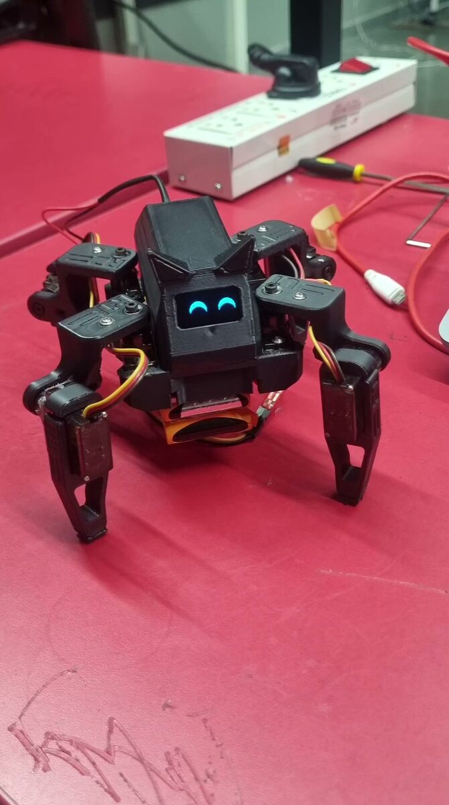
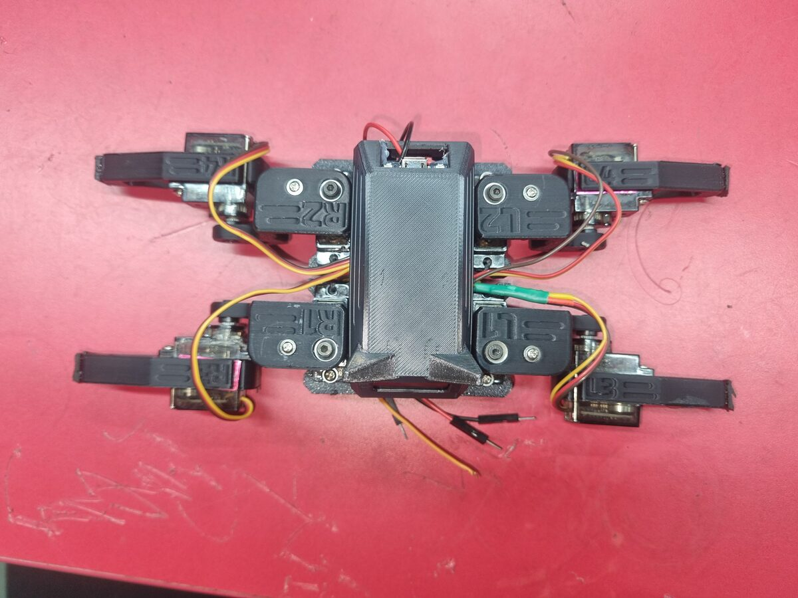

# TROJAN

An 8-servo ESP32 quadruped built from the open-source [Sesame Robot](https://github.com/dorianborian/sesame-robot), running its own from-scratch firmware with a phone remote, smooth gaits, tricks, dances and an animated OLED face.

<p align="center">
  
  
</p>

Built by **Team Trojans** for the Robotics Club mini project (30 Oct – 10 Nov 2026; firmware improved to v3.0 by 18 Nov 2026).

## What it does

- **Walks** in three gaits (crawl, trot, run) in any direction, with turning, from a joystick on the phone
- **18 tricks and 8 beat-locked dances**, plus a Pose Lab and dance builder for making your own
- **Animated face**: eyes with pupils, moods, and an idle personality on a 128×64 OLED
- **Own Wi-Fi hotspot** (`Sesame-Controller`) with a captive-portal remote: no router or internet needed
- **Drift fix**: steering trim and per-leg tuning, so it walks straight

## Hardware

| Part | Used |
|---|---|
| Controller | ESP32 DevKit (30-pin, ESP-WROOM-32) |
| Servos | 8 × TowerPro MG90S (2 per leg: hip + foot) |
| Display | 0.96" SSD1306 OLED, I2C |
| Power | 2 × 3.7 V 1S LiPo 1300 mAh: one for the ESP32, one for the servos, common ground |
| Wiring | Custom perfboard: shared servo power and GND rails + 8 signal headers |
| Body | 3D-printed PLA, from the Sesame design |

### Pin map

| Index | Joint | GPIO |
|---|---|---|
| 0 | R1 front-right hip | 14 |
| 1 | R2 rear-right hip | 27 |
| 2 | L1 front-left hip | 13 |
| 3 | L2 rear-left hip | 12 |
| 4 | R4 rear-right foot | 33 |
| 5 | R3 front-right foot | 32 |
| 6 | L3 front-left foot | 25 |
| 7 | L4 rear-left foot | 26 |
| OLED | SDA / SCL | 21 / 22 |

## Flashing

1. Open `firmware/TROJAN_Robot_v3/TROJAN_Robot_v3.ino` in the Arduino IDE.
2. Board: **ESP32 Dev Module**. Libraries: **ESP32Servo**, **Adafruit GFX**, **Adafruit SSD1306**.
3. Upload, join the Wi-Fi `Sesame-Controller` (default password `12345678`, changeable from the remote), and the remote opens by itself (or go to `http://192.168.4.1`).

## Repository layout

```
firmware/
  TROJAN_Robot_v3/        current firmware (3.0)
  TROJAN_Robot_v2/        2.0: gaits, tricks, dances, Pose Lab
  TROJAN_Robot/           1.0: first from-scratch rewrite, measured-geometry gait
  SesameRobot_Custom_v2/  official firmware with our tweaks
  SesameRobot_Custom/     official firmware adapted to our pins and limits
  archive/                the original download
cad/
  sesame-esp32/           Sesame ESP32 robot CAD (Fusion 360 .f3z + .step)
  experiments/            scaled-up MG995 body experiment (Python CAD, STEP/STL)
docs/                     project documentation (.docx/.pdf), v4 plan, photos, diagrams
media/videos/             build and walking videos
```

## Documentation

The full write-up (mechanics, electronics, firmware, problems and fixes) is in [`docs/TROJAN_Project_Documentation.pdf`](docs/TROJAN_Project_Documentation.pdf). The walking video is [`media/videos/5_WALKING_VIDEO_final_Nov11.mp4`](media/videos/5_WALKING_VIDEO_final_Nov11.mp4).

## Credits and license

Based on the [Sesame Robot](https://github.com/dorianborian/sesame-robot) by Dorian ([@dorianborian](https://github.com/dorianborian)), licensed under Apache-2.0. This project is released under the same [Apache-2.0 license](LICENSE); see [NOTICE](NOTICE) for what was changed.
